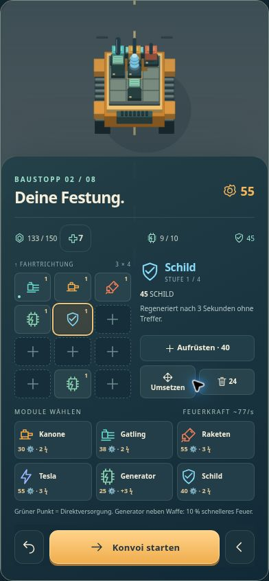

# Turm auf Rädern 2.0 · Eisenkarawane

Mobiles Three.js-Roguelite im Hochformat. Acht Sektoren, modulare Kettenfestung, automatische Geschütze und freie Ein-Daumen-Steuerung. Lokale Bibliothek, kein Build, keine CDN-Abhängigkeit, keine Anmeldung.

*Garage im Browsertest bei 390 × 844 Pixeln; Canvas-Kompatibilitätsansicht.*

## Die Überarbeitung

- Drei Gefechte pro Sektor. Erste Feinde nach etwa einer Sekunde; zwischen Gefechten fährt der Konvoi weiter. Der Baustopp folgt nach der dritten geräumten Blockade.
- Drei sofort spielbereite Startfestungen: Allrounder, Sturmspule und Belagerer. Auf Wunsch vor Abfahrt frei konfigurieren.
- Sechs Waffen-/Versorgungsmodule, vier Stufen, echtes Energie-Budget und Nachbarschaftsbonus: Waffen direkt neben Generatoren feuern 10 % schneller.
- Neue Garage: auswählen, ausdrücklich einbauen, gezielt umsetzen, belegt tauschen, aufrüsten oder zerlegen. Bauaktionen lassen sich während des Werkstattbesuchs rückgängig machen.
- Fünf Gegnerrollen: Räumer, seitlich ausweichende Drohnen, Artillerie-Panzer, angekündigte Scharfschützen und aufladende Rammfahrzeuge. Angriffe bleiben nach dem Tod ihres Schützen aktiv.
- Eisenbrecher mit zweiter Kampfphase, Verstärkungen, Sperrfeuer, Artillerielücken und angekündigtem Strahlangriff.
- Magnetisch angezogener Schrott, Versorgungskisten, Reparaturfunde, explosive Fässer und Abschuss-Serien.
- Acht kombinierbare Verbesserungen mit einmaligem kostenlosem Neuwurf pro Sektor. Nach Sektor 2, 4 und 6: Räuberpass mit mehr Beute oder vollständige Reparatur.
- Vier Umgebungen: Salzstraße/Wüste, Industriebezirk, Kupferschlucht und nächtliche Bastion. Neue abgerundete Fahrzeugmodelle, bewegte Ketten, Rückstoß, Funken, Trümmer, Mündungsfeuer, Trefferanzeigen und elektrische Entladungen.
- Motor, unterschiedliche Waffenklänge und Explosionen werden lokal synthetisiert. Grafikstufen, Vibration und reduzierte Kamerabewegung sind einstellbar.

## Steuerung

Finger irgendwo auf die freie Spielwelt legen und ziehen. Die Festung folgt dem Daumen; Zielen und Feuern funktionieren automatisch. Bei roten Linien und Einschlagsmarkierungen ausweichen. Auf dem PC alternativ WASD / Pfeiltasten, P oder Escape für Pause. Beim App-Wechsel pausiert die Fahrt.

## Speicherung und Migration

Der bisherige Schlüssel `spielwiese.turm-raeder.v1` bleibt erhalten. Version-1-Spielstände werden in Version 2 übernommen; Hülle, Module, Ressourcen, Werkstatt und Sektor gehen nicht verloren. Der Schaden aus der alten Werkstatt wird bei der Migration übernommen.

Während eines Gefechts bleibt der Sicherungspunkt vor der Abfahrt aktiv. Ein Neuladen wiederholt den Sektor ab diesem Punkt und verdoppelt keine Kampferträge. Nach Sektorabschluss werden die verfügbaren Upgrades gesichert. Neuwurf und Routenwahl werden ebenfalls gespeichert und können nicht mehrfach abgeholt werden. Bauaktionen speichern direkt. Andere Spiele und ihre Schlüssel werden nicht verändert.

## Technik und Prüfen

`node --test turm-auf-raedern/tests/*.mjs`

Die Simulation ist vom Renderer und der Oberfläche getrennt und läuft in festen 60-Hz-Schritten. Eine eigene Zufallsfolge macht Gefechte unabhängig vom Render-Timing reproduzierbar. Projektiltreffer verwenden kontinuierliche Segmentprüfung; schnelle Schüsse tunneln nicht durch Ziele. Umgebung und Projektile werden im WebGL-Renderer gebündelt. Dynamische Projektil-Batches werden nicht durch veraltete Sichtbarkeitsgrenzen ausgeblendet. Eigene Effektmaterialien und Warngeometrien werden nach Gebrauch freigegeben.

Tests decken Startfestungen, Energie, Baukosten, Umsetzen, Nachbarschaft, Reparaturen, Speicher-Migration, einmalige Belohnungen, drei Gefechte, Gegnerankündigungen, schnelle Projektile, gleichzeitige tödliche Treffer, vollständige Kampagne, Three.js-Szenenaufbau aller Regionen und die Hochformat-Kamera ab.

Browserprüfung bei 390 × 844 CSS-Pixeln: Fortsetzen eines alten Spielstands, Garage, Umsetzen, Rückgängig, Daumensteuerung, Kampf und Menüabläufe. Der Testbrowser hat kein WebGL; die sichtbare Prüfung erfolgt dort mit der leichten Canvas-Kompatibilitätsansicht. Die reguläre Three.js-Szene wird zusätzlich mit echten Geometrien und Matrizen sowie einem Renderer-Testadapter geprüft. Das ersetzt keinen GPU-Test auf einem echten Android-/iOS-Gerät.

Lokal: im Repository einen HTTP-Server starten, z. B. `python3 -m http.server 8000`, und `/turm-auf-raedern/` öffnen.

## Lizenzen

Three.js r170: MIT, siehe `vendor/THREE-LICENSE.txt`. Modelle, Umgebung, Symbole, Oberfläche und Klänge entstehen direkt aus dem Projektcode. Keine fremden Spiel-Assets.
